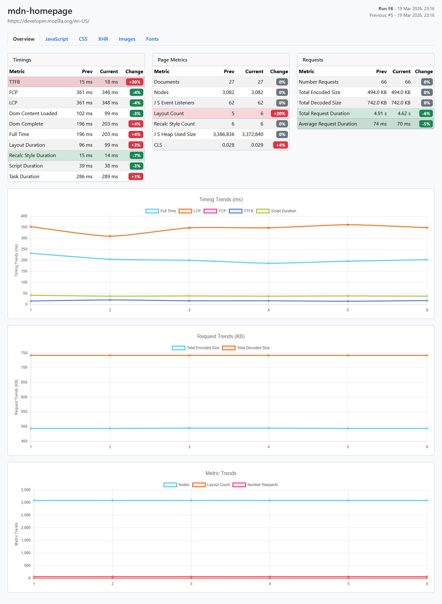

# Puppeteer Perf

Measure and monitor website performance with Headless Chrome and Puppeteer.

## Features

- Run performance tests in real Chrome - no emulation or estimation
- **Core Web Vitals** - LCP, FCP, CLS via PerformanceObserver
- **Navigation Timing API v2** - TTFB, DOM loaded, full page load
- **Chrome DevTools metrics** - DOM nodes, JS heap size, layout/restyle counts, script duration
- **Request breakdown** by type (JS, CSS, XHR, images, fonts) - sizes, durations, counts
- Write performance assertions as Vitest test cases
- Self-contained HTML reports with trend charts, run-over-run comparison, and percentage change tracking
- Only 2 runtime dependencies: `puppeteer` and `lowdb`

## Getting started

```bash
npm install
```

### Run directly

```bash
# Default: https://developer.mozilla.org/en-US/, 3 iterations
npm start

# Custom URL, test name, iterations
node src/runner.js https://example.com my-test 5
```

### Run as tests

```bash
npm test
```

### Example test

```js
import { describe, test, expect, beforeAll, afterAll } from "vitest";
import puppeteer from "puppeteer";
import { measurePageLoad } from "../src/measure/page-load.js";

let browser;
beforeAll(async () => { browser = await puppeteer.launch(); });
afterAll(async () => { if (browser?.connected) await browser.close(); });

describe("MDN Homepage", () => {
    let runData;
    beforeAll(async () => {
        runData = await measurePageLoad(browser, "mdn-homepage", "https://developer.mozilla.org/en-US/", 3);
    });

    test("full page load under 5s", () => {
        expect(runData.timings.fullTime).toBeLessThan(5000);
    });

    test("LCP under 3s", () => {
        expect(runData.timings.lcp).toBeLessThan(3000);
    });

    test("minimal layout shift", () => {
        expect(runData.metrics.cls).toBeLessThan(0.25);
    });
});
```

## Reports

Each run generates a self-contained HTML report in `generated/pageload/` comparing the current run to the previous. The report data is embedded as JSON and rendered client-side with Bootstrap 5 and Chart.js 4.

Reports include:
- Run ID and timestamp for current and previous runs
- Timings, page metrics, and request summary tables with previous vs current comparison
- Colour-coded percentage change badges (green = improved, red = regressed)
- Per-type tabs (JS, CSS, XHR, Images, Fonts) with top 5 largest/slowest resources
- Trend charts tracking metrics across the last 20 runs

All output (reports and historical data) is stored under `generated/`.



## What's measured

| Category | Metrics |
|----------|---------|
| **Timings** | TTFB, FCP, LCP, DOM Content Loaded, DOM Complete, Full Load, Layout/Script/Restyle/Task Duration |
| **Page Metrics** | DOM Nodes, Documents, JS Event Listeners, Layout Count, Restyle Count, JS Heap Size, CLS |
| **Requests** | Count, encoded/decoded size, total/average duration - per type: JS, CSS, XHR, Images, Fonts |

## How it works

1. Launches headless Chrome via Puppeteer
2. Injects PerformanceObservers for LCP, FCP, and CLS before navigation
3. Navigates to the URL with cache disabled, waits for `networkidle0`
4. Captures Chrome trace data (in-memory, no temp files in the project)
5. Collects Navigation Timing API v2, Chrome DevTools metrics, and Web Vitals
6. Repeats for the configured number of iterations, averages timing/metric results, uses median iteration for request breakdown
7. Stores results in `generated/data.json` via lowdb
8. Generates an HTML report comparing against the previous run with trend charts

## Project structure

```
src/
  metrics/       Chrome DevTools, Navigation Timing, Web Vitals, trace extraction
  measure/       Page load orchestration and iteration logic
  report/        Report data assembly + self-contained HTML template
  storage/       Run history persistence (lowdb flat file)
  utils/         Metric normalization and diffing
tests/           Vitest test suites
generated/       Output directory (reports + data.json) - gitignored
```
